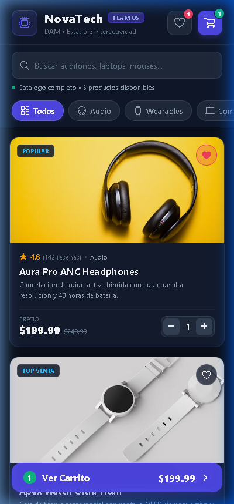
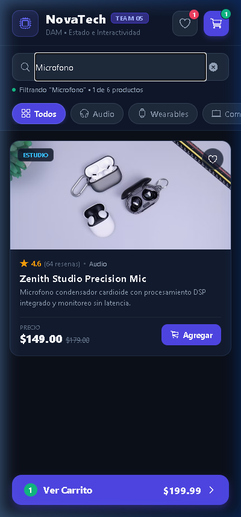
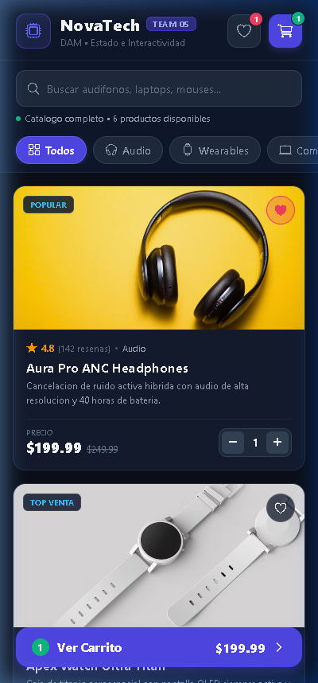
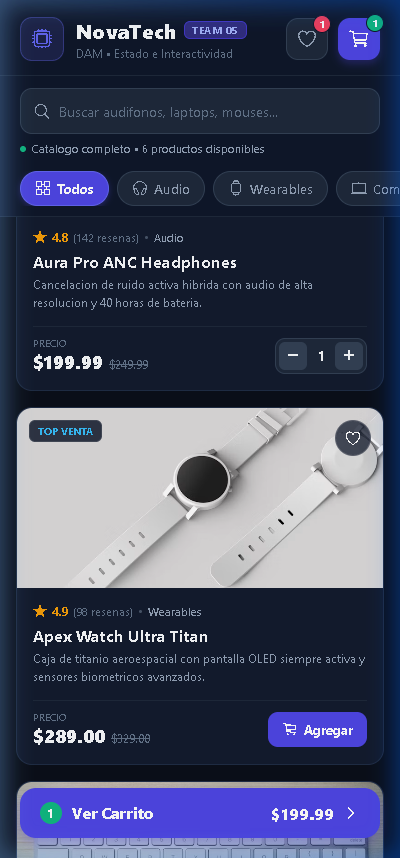

# S09 | M09 — Manejo de Estados y Lógica de Componentes
## Aplicaciones Móviles (DAM) — React Native + Expo

---

### Información General de la Entrega

- **Equipo:** Team 05
- **Repositorio GitHub:** `S09_T05_DAM`
- **Nombre de la Aplicación:** **NovaTech — Smart Gear & Audio Store**
- **Plataforma:** React Native + Expo (Mobile / Web)
- **Diseño:** Modern Dark Theme con acentos índigo y esmeralda, tipografía jerárquica, micro-interacciones y uso exclusivo de iconografía vectorial (`@expo/vector-icons / Ionicons`) sin emojis.

---

### Evidencias Visuales (Capturas de Pantalla)

| Vista Principal y Catálogo Inicial | Búsqueda Reactiva en Tiempo Real |
| :---: | :---: |
|  |  |

| Interacción de Favoritos y Badges Dinámicos | Exploración y Acciones del Catálogo |
| :---: | :---: |
|  |  |

---

### Respuestas a las Preguntas de la Actividad

#### Pregunta 1: ¿Qué estados utilizaron en su aplicación, qué información almacena cada uno y para qué se utiliza?

En la aplicación se empleó el hook `useState` de React para gestionar 7 estados principales que transforman la interfaz de estática a totalmente interactiva:

1. **`searchQuery` (Tipo: `string`)**:
   - *Información que almacena:* Almacena el texto ingresado por el usuario en el campo de búsqueda (`TextInput`).
   - *Para qué se utiliza:* Filtra en tiempo real los productos del catálogo por coincidencia de nombre o descripción, actualizando el listado visible y el contador de resultados.
2. **`selectedCategory` (Tipo: `string`)**:
   - *Información que almacena:* El identificador de la categoría activa seleccionada (`'all'`, `'audio'`, `'wearables'`, `'computing'`, `'gaming'`).
   - *Para qué se utiliza:* Segmenta los productos visibles según la categoría seleccionada y controla el estilo activo de los botones pill (`Pressable`).
3. **`favorites` (Tipo: `Array<number>`)**:
   - *Información que almacena:* Arreglo con los IDs numéricos de los productos marcados como favoritos por el usuario.
   - *Para qué se utiliza:* Determina si el icono de corazón se muestra relleno o en contorno para cada tarjeta, y alimenta el badge contador en el encabezado.
4. **`showOnlyFavorites` (Tipo: `boolean`)**:
   - *Información que almacena:* Bandera booleana que indica si el modo de filtrado exclusivo de favoritos está activo o inactivo.
   - *Para qué se utiliza:* Permite al usuario alternar entre ver el catálogo completo o únicamente los artículos que ha guardado.
5. **`cart` (Tipo: `Array<CartItem>`)**:
   - *Información que almacena:* Lista de objetos en el carrito de compras, donde cada elemento contiene: `{ id, name, price, image, quantity }`.
   - *Para qué se utiliza:* Mantiene las cantidades elegidas, calcula subtotales, descuentos y total a pagar, y controla los botones de suma/resta.
6. **`isCartOpen` (Tipo: `boolean`)**:
   - *Información que almacena:* Estado booleano de visibilidad del modal interactivo del carrito.
   - *Para qué se utiliza:* Despliega u oculta el resumen de compra y la sección de cupones mediante el componente `Modal`.
7. **`orderData` / `isSuccessOpen` (Tipo: `Object | null` y `boolean`)**:
   - *Información que almacena:* Los datos finales de la orden procesada (código de orden, total pagado, cantidad de artículos) y la visibilidad del modal de confirmación.
   - *Para qué se utiliza:* Muestra la pantalla de confirmación con diseño tipo recibo digital una vez que el usuario finaliza su compra.

---

#### Pregunta 2: ¿Qué acciones realiza el usuario y cómo estas provocan cambios en los estados de la aplicación?

El ciclo de interacción sigue el principio fundamental de React: **Acción del usuario → Disparo de Evento → Actualización del Estado (`setter`) → Re-renderizado de la Interfaz**:

1. **Escribir en el campo de búsqueda:**
   - *Acción:* El usuario escribe en el `TextInput`.
   - *Evento:* `onChangeText={(text) => setSearchQuery(text)}`.
   - *Efecto:* Modifica `searchQuery`, activando inmediatamente el recálculo derivado de `filteredProducts`.
2. **Seleccionar una categoría:**
   - *Acción:* El usuario pulsa una pastilla (`Pressable`) de categoría (ej. "Gaming").
   - *Evento:* `onPress={() => setSelectedCategory(cat.id)}`.
   - *Efecto:* Modifica `selectedCategory`, cambiando el estilo del chip a color índigo resaltado y filtrando los productos visibles.
3. **Marcar o desmarcar favorito:**
   - *Acción:* El usuario presiona el botón de corazón en una tarjeta de producto.
   - *Evento:* `onPress={() => handleToggleFavorite(product.id)}`.
   - *Efecto:* Ejecuta `setFavorites((prev) => prev.includes(id) ? prev.filter(...) : [...prev, id])`. El icono cambia de color y el contador del Header incrementa o decrementa.
4. **Agregar al carrito o alterar cantidades:**
   - *Acción:* El usuario pulsa "Agregar" o los botones `+` / `-`.
   - *Evento:* `onPress={() => handleAddToCart(product)}` o `handleRemoveFromCart(productId)`.
   - *Efecto:* Actualiza la propiedad `quantity` en el estado `cart`. Si la cantidad llega a 0, el producto se elimina automáticamente.
5. **Aplicar un cupón de descuento:**
   - *Acción:* En el carrito, el usuario escribe `"TEAM05"` y pulsa "Aplicar".
   - *Evento:* `onPress={handleApplyCoupon}`.
   - *Efecto:* Valida el código y actualiza `couponApplied` a `true`, aplicando un 15% de descuento al monto total.
6. **Confirmar la compra:**
   - *Acción:* El usuario presiona el botón "Confirmar y Pagar".
   - *Evento:* `onPress={() => onCheckout(...)}`.
   - *Efecto:* Vacía el carrito (`setCart([])`), guarda el resumen en `orderData` y abre el modal de confirmación (`setIsSuccessOpen(true)`).

---

#### Pregunta 3: ¿Qué cambios se producen en la interfaz y qué lógica condicional utilizaron para controlarlos?

Se implementó lógica condicional mediante **operadores ternarios (`? :`)** y **evaluación lógica de cortocircuito (`&&`)**:

1. **Alternancia de iconos y estilos de favoritos (Operador Ternario):**
   ```jsx
   <Ionicons
     name={isFavorite ? 'heart' : 'heart-outline'}
     size={18}
     color={isFavorite ? '#F43F5E' : '#FFFFFF'}
   />
   ```
   *Efecto visual:* Cuando el producto está en `favorites`, el icono pasa de ser un contorno blanco a un corazón relleno en rojo carmesí con fondo translúcido.

2. **Controlador de Cantidad vs. Botón Agregar (Operador Ternario):**
   ```jsx
   {isInCart ? (
     <View style={styles.stepperContainer}>
       <Pressable onPress={() => onRemoveFromCart(product.id)}>
         <Ionicons name="remove-outline" size={16} color="#F8FAFC" />
       </Pressable>
       <Text style={styles.stepValueText}>{cartQuantity}</Text>
       <Pressable onPress={() => onAddToCart(product)}>
         <Ionicons name="add-outline" size={16} color="#F8FAFC" />
       </Pressable>
     </View>
   ) : (
     <Pressable style={styles.addCartBtn} onPress={() => onAddToCart(product)}>
       <Ionicons name="cart-outline" size={16} color="#FFFFFF" />
       <Text>Agregar</Text>
     </Pressable>
   )}
   ```
   *Efecto visual:* Si la cantidad en el carrito es 0 se muestra el botón "Agregar". Si el usuario ya lo agregó, inmediatamente se transforma en un control interactivo de suma/resta.

3. **Insignias numéricas reactivas (Operador `&&`):**
   ```jsx
   {cartCount > 0 && (
     <View style={styles.cartBadge}>
       <Text style={styles.badgeText}>{cartCount}</Text>
     </View>
   )}
   ```
   *Efecto visual:* La burbuja indicadora sobre el carrito de compras solo se renderiza si existen elementos, desapareciendo cuando el carrito está en cero.

4. **Banner de filtro de favoritos y botón de limpiar búsqueda (Operador `&&`):**
   ```jsx
   {showOnlyFavorites && (
     <View style={styles.favoriteActiveBanner}>
       <Ionicons name="heart" size={16} color="#F43F5E" />
       <Text>Mostrando tus {favorites.length} favoritos</Text>
     </View>
   )}

   {value.length > 0 && (
     <Pressable onPress={onClear}>
       <Ionicons name="close-circle" size={18} color="#94A3B8" />
     </Pressable>
   )}
   ```

5. **Vista de Lista vs. Estado Vacío (Operador Ternario):**
   ```jsx
   {filteredProducts.length === 0 ? (
     <View style={styles.emptyResultsWrapper}>
       <Ionicons name="search-outline" size={40} color="#64748B" />
       <Text>Sin resultados encontrados</Text>
       <Pressable onPress={resetFilters}>
         <Text>Restablecer Filtros</Text>
       </Pressable>
     </View>
   ) : (
     <FlatList data={filteredProducts} ... />
   )}
   ```
   *Efecto visual:* Si la búsqueda o filtro no produce coincidencias, se oculta la lista y se presenta una vista amigable con opción de restablecimiento.

---

### Instrucciones para Ejecutar el Proyecto

1. **Abrir la terminal en la carpeta del proyecto:**
   ```bash
   cd S09_T05_DAM
   ```
2. **Iniciar la aplicación en el navegador web:**
   ```bash
   npm run web
   ```
3. **Iniciar en dispositivo móvil con Expo Go:**
   ```bash
   npm start
   ```
   Escanear el código QR con la cámara (iOS) o la app Expo Go (Android).
